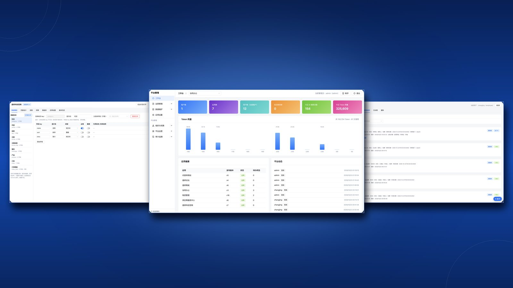
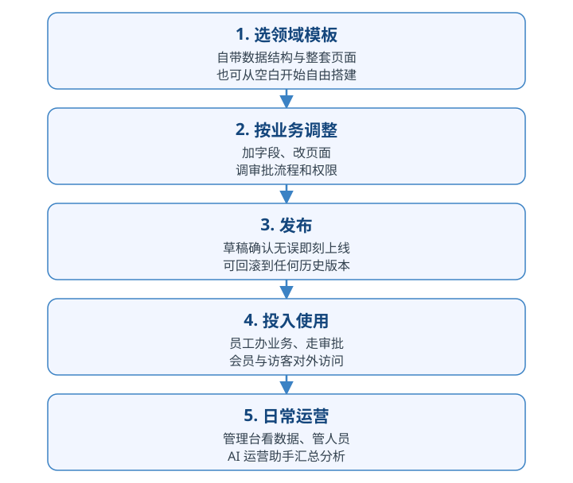

# AI + 低代码平台

**利用智能体和领域模型，让懂业务的人把想法转变成企业级可直接上线运行的应用系统。**

## 平台技术栈

平台全栈使用 TypeScript：前端、服务端与边缘网关共用同一套设计结构定义，应用在设计、预览、上线三个阶段由同一套渲染器呈现，所见即所得。

| 层 | 技术 |
| --- | --- |
| 开发语言 | TypeScript（前端、服务端、边缘网关全栈统一） |
| 前端应用 | React 18 + Vite 6 + Ant Design 5（运行端、管理台两个应用） |
| 页面渲染 | 自研页面渲染器 + 共享组件库（设计预览与正式运行共用同一套渲染逻辑） |
| 流程设计 | React Flow（流程图节点编排） |
| 边缘网关 | Cloudflare Workers + Hono（请求转发、公开内容缓存、源站不可用时降级浏览） |
| 前端托管 | Cloudflare Pages；静态快照分发用 Cloudflare R2，降级缓存用 Cloudflare KV |
| 服务端 | Node.js + Hono（业务接口与智能体两个独立服务，Docker 容器运行） |
| 数据库 | PostgreSQL 18 + pgvector（业务数据与知识库向量检索同库）；Redis（运行时缓存） |
| 数据校验 | Zod（设计结构与接口入参的模式校验） |
| AI 接入 | OpenAI 兼容接口双通道（对话模型与向量模型分别配置，向量维度可配） |
| 移动端 | Capacitor 8（同一套 Web 应用打包为 Android / iOS App） |
| 工程与交付 | pnpm monorepo；GitHub Actions 构建 Docker 镜像并发布到 GHCR，服务器侧 Docker 编排部署 |

## 平台预览



**平台测试地址**

| 入口 | 地址 | 管理员账号 / 密码 |
| --- | --- | --- |
| 应用运行 | [www.coode.cc.cd](https://www.coode.cc.cd) | `admin` / `AdminDemo@26` |
| 应用管理 | [admin.coode.cc.cd](https://admin.coode.cc.cd) | `admin` / `AdminDemo@26` |

## 从想法到上线的五步



## 功能一览

<table>
<thead>
<tr><th align="left" width="180">功能</th><th align="left">描述</th></tr>
</thead>
<tbody>
<tr><td nowrap><strong>领域模版</strong></td><td>内置内容发布、商城、论坛、在线客服、协同办公等多套领域模版，数据结构、页面、流程与权限成套预置；支持空白创建与自定义扩展</td></tr>
<tr><td nowrap><strong>单据仓库</strong></td><td>协同办公模版附带的预置单据集合，请假、报销、付款、入职等单据各自包含数据结构、审批流程、页面与权限，勾选后整套装入应用</td></tr>
<tr><td nowrap><strong>数据建模</strong></td><td>以表单方式定义数据表与字段，支持文本、数字、日期、选项、附件、富文本、关联与主子表等类型，并可设置校验规则、默认值与唯一约束</td></tr>
<tr><td nowrap><strong>页面设计</strong></td><td>列表页与表单页自动生成，亦可自由编排自定义页面；菜单由页面驱动，同一页面支持电脑与手机两套布局</td></tr>
<tr><td nowrap><strong>流程设计</strong></td><td>以图形化方式编排审批流程，节点、审批角色、状态回写与驳回处理均可可视化配置</td></tr>
<tr><td nowrap><strong>数据权限</strong></td><td>按角色配置菜单与操作权限，支持行级数据范围（本人、本部门、全部）、字段只读与敏感字段脱敏，由服务端统一执行</td></tr>
<tr><td nowrap><strong>助手配置</strong></td><td>为应用配置其自身的运行助手：员工助手、访客助手、运营助手分别设定形象、能力边界与知识来源</td></tr>
<tr><td nowrap><strong>生成向导</strong></td><td>只服务新建应用：通过对话从零逐步生成，依次完成数据模型、页面、流程与权限，每一步经确认后落稿，成果与手工搭建一致且可继续修改</td></tr>
<tr><td nowrap><strong>设计助手</strong></td><td>通过智能体协助创建应用：在应用设计中以对话方式完成字段、页面与流程的新增和调整，变更以提案形式提交，确认后生效</td></tr>
<tr><td nowrap><strong>版本发布</strong></td><td>草稿与已发布版本分离管理，发布一键完成，并可回滚至任意历史版本</td></tr>
<tr><td nowrap><strong>应用管理</strong></td><td>应用的创建、改名、启用与停用，支持设置主应用，并集中查看各应用运行状态</td></tr>
<tr><td nowrap><strong>权限管理</strong></td><td>统一维护平台用户、角色与菜单权限，决定用户可进入的应用与可见菜单</td></tr>
<tr><td nowrap><strong>角色管理</strong></td><td>预置角色与自定义角色并存，按角色成套配置数据范围与操作权限</td></tr>
<tr><td nowrap><strong>运营授权</strong></td><td>可将指定应用的运营权限授予特定人员，其登录后仅能访问被授权的应用</td></tr>
<tr><td nowrap><strong>领域管理</strong></td><td>各类应用设有专属管理页面，文章、订单、工单、会员等对象按业务形态分别管理</td></tr>
<tr><td nowrap><strong>数据修正</strong></td><td>管理人员可在管理台直接修正业务数据，全部修改记录进入审计日志</td></tr>
<tr><td nowrap><strong>主题模版</strong></td><td>电脑与手机主题分别配置，可选用领域主题或上传应用专属主题，预览确认后启用</td></tr>
<tr><td nowrap><strong>域名绑定</strong></td><td>每个应用可绑定独立域名，未绑定时使用平台默认域名下的专属路径</td></tr>
<tr><td nowrap><strong>系统配置</strong></td><td>AI 模型接入、支付参数、邮件发送等平台级参数集中维护，修改后即时生效</td></tr>
<tr><td nowrap><strong>审计日志</strong></td><td>全量记录操作人、时间与变更内容，支持按应用、人员与记录检索及过程回放</td></tr>
<tr><td nowrap><strong>熔断控制</strong></td><td>AI 调用按用途分池计量，用量可查；超出预算自动熔断并阻断后续调用</td></tr>
<tr><td nowrap><strong>待办中心</strong></td><td>跨应用汇聚待办事项，含待我审批、我发起的、已处理与通知四类视图，支持催办与流程时间线查看</td></tr>
<tr><td nowrap><strong>审批处理</strong></td><td>多级审批按角色自动分派，审批通过或驳回后自动回写单据状态，全过程留痕</td></tr>
<tr><td nowrap><strong>内容发布</strong></td><td>栏目、文章与公开页面统一管理，发布后生成静态副本以提升访问速度</td></tr>
<tr><td nowrap><strong>官网表单</strong></td><td>官网留言、报名等表单的提交自动进入后台，形成可跟进的业务数据</td></tr>
<tr><td nowrap><strong>商城经营</strong></td><td>提供商品、购物车、结算下单与订单处理，收款经第三方支付完成，平台不经手资金</td></tr>
<tr><td nowrap><strong>论坛社区</strong></td><td>提供版块、发帖、回复与会员互动，会员版主可执行置顶、加精与违规处理</td></tr>
<tr><td nowrap><strong>在线客服</strong></td><td>访客咨询优先由 AI 依据知识库应答，未能解决或访客要求人工时自动转工单，由客服人员接续处理</td></tr>
<tr><td nowrap><strong>会员中心</strong></td><td>会员注册、登录与资料管理，注册环节配图形验证码防刷，支持手机与电脑多端使用</td></tr>
<tr><td nowrap><strong>授权访问</strong></td><td>官网、商城与论坛加入同一会员域、共享会员体系，会员一次注册，即可凭授权访问全部关联应用</td></tr>
<tr><td nowrap><strong>账户中心</strong></td><td>会员身份集中于统一账户中心管理，各应用通过单点登录接入</td></tr>
<tr><td nowrap><strong>会员角色</strong></td><td>版主等身份在会员体系内任命与收回，与平台员工账号体系相互独立</td></tr>
<tr><td nowrap><strong>员工助手</strong></td><td>以自然语言的方式协助员工查询数据、生成汇总、起草单据与发起流程；数据变更先出草稿、确认后执行，访问范围限于本人权限</td></tr>
<tr><td nowrap><strong>访客助手</strong></td><td>全天候应答访客咨询，答案仅来源于已审核的知识库内容</td></tr>
<tr><td nowrap><strong>运营助手</strong></td><td>在管理台内以对话方式查询运营数据、待办事项与汇总结果</td></tr>
<tr><td nowrap><strong>知识库</strong></td><td>文档与常见问题经语义检索供 AI 应答，内容须先审核后发布，未审核资料不会被引用</td></tr>
<tr><td nowrap><strong>移动布局</strong></td><td>页面配置手机布局时优先呈现，未配置时自动适配窄屏，手机浏览器可直接使用</td></tr>
<tr><td nowrap><strong>移动设备</strong></td><td>同一应用可打包为 Android 与 iOS 应用发布，支持扫码、拍照等移动设备能力</td></tr>
<tr><td nowrap><strong>访问控制</strong></td><td>对外仅展示已发布内容，未发布草稿即使获知地址亦无法访问</td></tr>
<tr><td nowrap><strong>降级浏览</strong></td><td>服务器宕机时，已发布的公开页面由边缘缓存副本持续提供浏览，服务恢复后自动切换回实时数据</td></tr>
<tr><td nowrap><strong>数据自有</strong></td><td>全部业务数据存储于自有服务器数据库，云端仅保存展示副本，更换云服务账号不影响业务数据</td></tr>
</tbody>
</table>
## 部署方式

平台分两处部署协同工作：**前端应用与访问网关部署在 Cloudflare**，就近为各地用户提供访问；**业务服务与数据库部署在自有服务器**（Docker 方式运行），数据始终留在自己服务器上。访问入口按应用分配：主应用使用平台默认域名， 其他应用绑定自有域名或使用默认域名下的专属路径。提供两个使用入口：

| 入口 | 给谁用 | 做什么 |
| --- | --- | --- |
| 应用运行 | 员工、会员、访客 | 办业务、走审批、看官网/商城/论坛、问客服 |
| 平台管理 | 管理员、运营人员 | 管应用、管数据、管人员、看审计，查统计 |

## 未来计划

目前平台采用"自有服务器 + Cloudflare 承载"的混合部署：业务接口与数据库运行在自有服务器，前端与访问网关部署在 Cloudflare、由边缘就近提供访问；技术栈为全栈 TypeScript，前端 React 18 + Vite + Ant Design 5，服务端 Node.js + Hono，设计、预览与运行由同一套自研渲染器呈现。

这套组合让平台以很低的成本跑了起来，全栈同一种语言也使迭代很快——这是当初选它的理由。但它的局限同样来自选择本身：边缘无状态、请求驱动，做不了 WebSocket 这类长连接实时交互；部署形态与 Cloudflare 深度绑定，企业内网与私有化部署难以落地；通用引擎广度有余、业务深度不足。下一步计划，就是针对这三条局限换路：

1. **前端迁移到 Vue 技术栈**：应用运行与平台管理逐步迁移至 Vue，页面设计结构保持不变、存量应用平滑过渡；与企业客户主流技术栈对齐，便于交付后的维护与二次开发。
2. **脱离 Cloudflare、完全独立部署**：前端、网关与接口全部收回自有服务器，以容器编排成单一交付形态，支持企业私有化部署与内网离线运行，不再依赖任何特定云厂商。
3. **挑 1–2 个领域做透做精**：选定少数领域把业务做到开箱即好用。例如在线客服领域——依托独立服务器的长连接能力，用 WebSocket 实现实时对话：消息即时推送、访客在线状态、已读回执、坐席实时接待；面向 B 端的领域（协同办公、进销存等）则把审批规则、业务报表与协同能力做得更深，从"能搭出来"进到"拿来就能用好"。

## 本仓说明

本仓库是平台部署在 Cloudflare 上的部分：前端应用与统一访问网关，与平台的服务器端仓库 `lcdp-platform` 配套发布。

| 目录 | 内容 |
| --- | --- |
| `apps/runtime` | 应用运行端：业务办理、待办中心、智能助手、客服浮窗 |
| `apps/admin` | 管理台：运营管理与集成的设计器 |
| `apps/studio` | 设计台：独立设计环境（已下线，设计器已并入管理台，代码保留） |
| `packages/renderer` | 页面渲染器：把设计好的页面结构渲染成真实界面，设计预览与正式运行共用同一套 |
| `packages/ui` | 共享界面组件库 |
| `src` | 统一访问网关：请求转发与源站不可用时的降级浏览 |

本地运行：

```bash
pnpm install
pnpm --filter @lcdp/runtime dev   # 本地起单个前端
pnpm dev                          # 本地起网关（wrangler dev）
```
